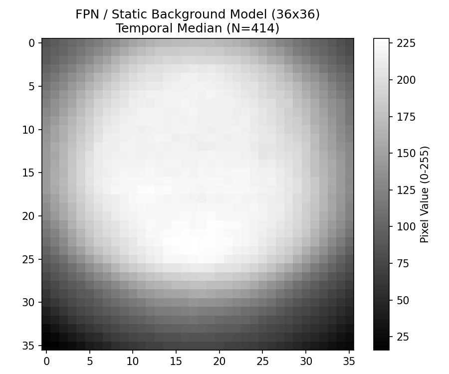
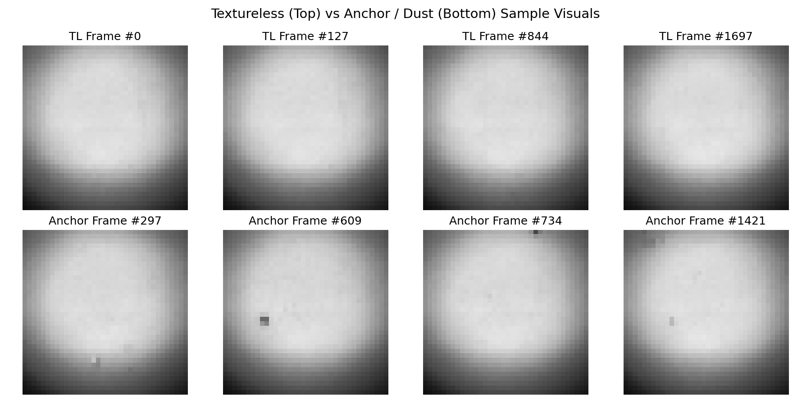
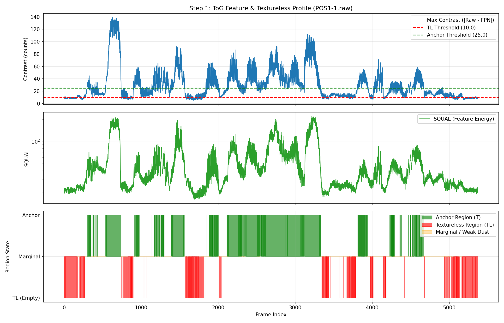

# Step 1 成果報告：真實 Raw 影像特徵分析與 Textureless 抽取

本報告針對真實錄製的 ToG 圓周運動 Raw 影像進行時序特徵分析、固定圖樣噪聲（FPN/背景光斑）建模，並成功分離出 **無特徵畫面（Textureless Frames）** 與 **高信任度錨點畫面（Anchor Frames）**。

---

## 1. 數據集與分析摘要

* **原始檔案**：`C:\Data\testPattern玻璃\Circle_R0.2inch_IPS0.02_Glass\RAW\POS1-1.raw`
* **影像規格**：$36 \times 36$ 解析度、8-bit、共 **5,373 幀**（約 82 FPS，機台以 $0.02\text{ ips}$ 等速畫圓）。
* **分類統計結果**：
  * **Textureless (TL) 空白玻璃畫面**：**856 幀 (15.9%)**
    * 特徵：全圖扣除 FPN 後的最大波動 $\le 10$ counts（佔 8-bit 的 $3.9\%$ 以下），無任何微塵特徵點，純為感測器讀出噪聲。
  * **Anchor (高信任度特徵) 畫面**：**1,915 幀 (35.6%)**
    * 特徵：微塵對比度 $\ge 25$ counts、連續特徵像素點 $\ge 3$、SQUAL 高。
  * **連續錨點簇（Anchor Clusters，長度 $\ge 5$ 幀）**：共 **42 個連續區段**（其中 Cluster 4 長達 186 幀、Cluster 6 長達 132 幀）。

---

## 2. 視覺對比與背景模型

### (1) 靜態背景模型 (FPN + Lens Shading Profile)
利用時序中位數濾波器（Temporal Median）排除了動態移動微塵，提煉出感測器的固定圖樣噪聲與鏡頭照明場（中央亮、周邊暗）：

### (2) 抽樣檢驗對比 (Textureless vs. Anchor)
上排為純玻璃畫面（完全平坦無特徵），下排為捕捉到微小灰塵粒子的清晰畫面：

---

## 3. 全序列特徵時序分佈圖 (5,373 幀)

下圖展示整段 5,373 幀在畫圓過程中的微塵對比度、SQUAL 能量以及區域狀態（綠色：Anchor 特徵區，紅色：Textureless 空白玻璃區，橘色：弱特徵邊緣區）：

---

## 4. 輸出產物清單與檢視方式

所有產出檔案均已存放於：
`C:\Users\Shouder Wei\.gemini\antigravity\scratch\tog_tracker\step1_output\`

1. **`textureless_extracted.raw`**：抽取出的 500 幀純平坦玻璃影像（OPNI 格式，128-byte Header）。
2. **`anchor_extracted.raw`**：抽取出的 500 幀高品質灰塵特徵影像。
3. **`fpn_model.raw` / `fpn_model.png`**：提煉出的靜態 FPN 背景模型。
4. **`step1_report.json`**：包含 42 個 Anchor 簇的幀範圍、長度與統計指標。
5. **`OPNI_raw_viewer.html`**：本地檢視器工具。
