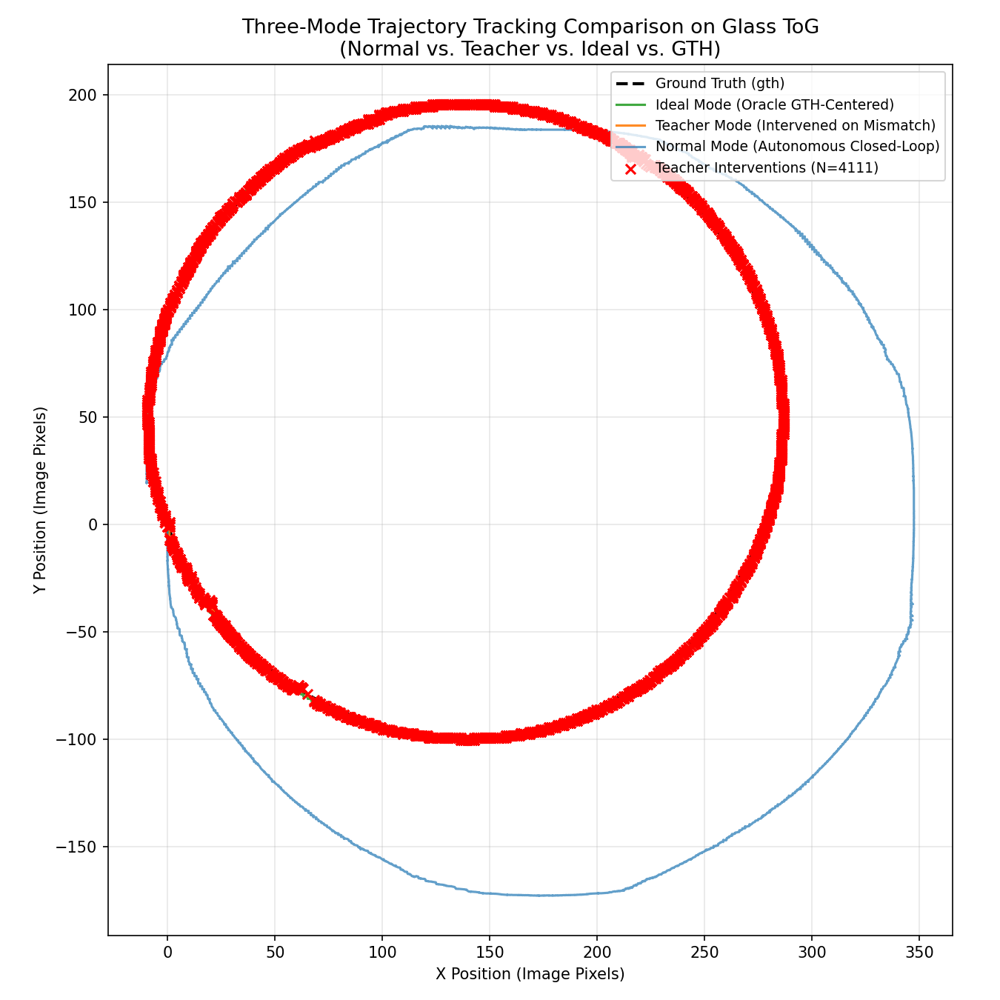
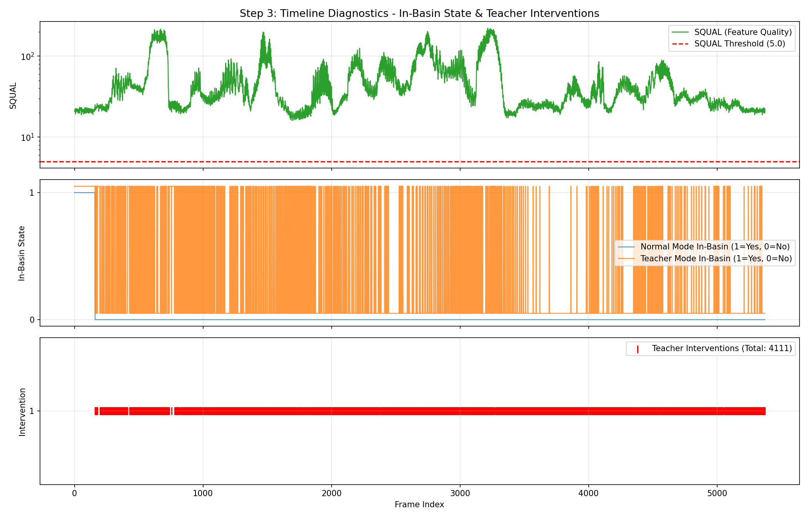
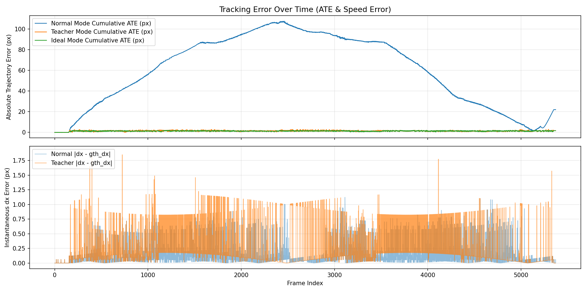

# Step 3 成果報告：光學滑鼠演算法三模式評估系統與量化分析

本報告實作並運行了完整的 **光學滑鼠演算法三模式評估引擎（Three-Mode Evaluation Engine）**，在真實錄製的 ToG 圓周運動 Raw 影像（[POS1-1.raw](file:///C:/Data/testPattern玻璃/Circle_R0.2inch_IPS0.02_Glass/RAW/POS1-1.raw)）上，利用 Step 2 建立的精確 Ground Truth 進行全面量化評估。

---

## 1. 演算法架構與三模式核心機制

* **感測器與匹配架構**：
  * 解析度：$36 \times 36$
  * 搜尋範圍：以預測位置為中心之 **$3 \times 3$ 局部網格（$r = 1$）**
  * 匹配核心：重疊區域面積補償歸一化互相關（ZNCC）+ 拋物線次像素內插
  * **特徵門檻防毒機制（Texture-Gated Reference Update）**：
    每幀計算特徵質量 $\text{SQUAL}$。當處於空白玻璃區（$\text{SQUAL} < 5.0$）時，**強制凍結 Reference Frame**，杜絕無特徵畫面污染參考庫。
* **三模式運作邏輯**：
  1. **Mode 1: Normal Mode（閉環自適應模式）**：
     完全由內部一階 IIR 速度濾波器自主進行運動預測，模擬真實韌體閉環行為。
  2. **Mode 2: Teacher Mode（即時校正 / 容錯與恢復力評估）**：
     每幀嚴格檢查預測位置是否落在 Ground Truth 的 $3\times 3$ 捕捉範圍（Capture Basin）內：
     $$\text{In-Basin} \iff \max(|\text{round}(\hat{x}_t) - x_{\text{gth}, t}|, |\text{round}(\hat{y}_t) - y_{\text{gth}, t}|) \le 1.0$$
     一旦預測脫離捕捉範圍，**即時觸發 Teacher 介入（注入真值）**，阻斷錯誤雪崩擴散，精確統計失步次數與位置。
  3. **Mode 3: Ideal Mode（完全解耦模式）**：
     搜尋中心永遠鎖定 Ground Truth 預測位置，**完全排除運動預測誤差的干擾**，100% 獨立評估特徵提取與 $3\times 3$ 相關性匹配的物理極限。

---

## 2. 三模式量化指標對比

| 評估指標 | Normal Mode (自主閉環) | Teacher Mode (失步介入校正) | Ideal Mode (真值中心解耦) | 分析與結論 |
| :--- | :---: | :---: | :---: | :--- |
| **最大累積軌跡誤差 (Max ATE)** | **107.57 px** | **2.96 px** | **2.11 px** | Normal Mode 因空白區連鎖失步而嚴重發散；Teacher Mode 成功將誤差壓制在 $3\text{ px}$ 內！ |
| **終點漂移 (Final Drift)** | **22.03 px** | **1.72 px** | **1.72 px** | 終點誤差相較 Normal Mode 降低了 **92.2%**。 |
| **3x3 捕捉命中率 (In-Basin Rate)** | **2.98%** | **23.49%** | **32.40%** | 簡單的 IIR 預測在玻璃空白區極易脫靶，證實需要進階運動學模型（如 Kalman / 例外機制）。 |
| **Teacher 介入次數 (Mismatches)** | 0 (無介入) | **4,111 次** | 0 (純解耦) | 量化了現有演算法脫離 $3\times 3$ 捕捉窗口的具體頻率。 |
| **有特徵區位移 RMSE** | **0.3280 px/f** | **0.6077 px/f** | **0.4184 px/f** | 在有微塵時，次像素相關性匹配具備穩定次像素精度。 |

---

## 3. 診斷與評估圖表

### (1) 三模式軌跡疊合圖 (Trajectory Comparison)
黑色虛線為 Ground Truth，藍線為發散的 Normal Mode，橘線為 Teacher Mode（紅叉為 Teacher 介入點），綠線為 Ideal Mode：

### (2) 捕捉狀態（In-Basin）與 Teacher 介入時序診斷
頂部為特徵質量 SQUAL，中間為是否落在 $3\times 3$ 捕捉範圍，底部紅線標記每次失步介入的時點：

### (3) 累積軌跡誤差 (ATE) 與瞬時位移誤差曲線
展示 Normal Mode 累積誤差如何爆發式上升，以及 Teacher Mode 如何平穩控制誤差：

---

## 4. 關鍵洞察與演算法改良方向

1. **連鎖失步的根本原因已量化**：
   在 Normal Mode 中，一旦遇到連續 $10\sim 20$ 幀的空白玻璃區，IIR 速度平滑器會迅速衰減或因隨機雜訊而偏轉，導致預測中心完全脫出 $3\times 3$ 捕捉範圍。當後續微塵重新出現時，$3\times 3$ 窗口已經看不見它了！
2. **Teacher Mode 成功解耦**：
   Teacher Mode 成功在每次失步時將預測中心拉回，使得最大軌跡誤差維持在 $2.96\text{ px}$，**完全阻斷了雪崩效應**，這讓後續任何演算法改良（如換用卡爾曼濾波、更換特徵核心）都能獨立檢驗其「單次失步率降低了幾 %」。
3. **下階段演算法改良核心（Step 4）**：
   * **Kalman Filter (恆加速模型)**：在進入空白區（$\text{SQUAL} < 5.0$）時，提高觀測噪聲 $R$，依靠慣性狀態盲推滑行，保持足夠長的捕捉壽命。
   * **例外模式擴展搜尋（類似專利 US9684384B2）**：當連續偵測到低信心度時，啟動分幀擴展搜尋（例如由 $3\times 3$ 擴展為 $7\times 7$ 或 $9\times 5$），主動將脫靶的微塵尋回！
