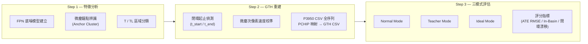
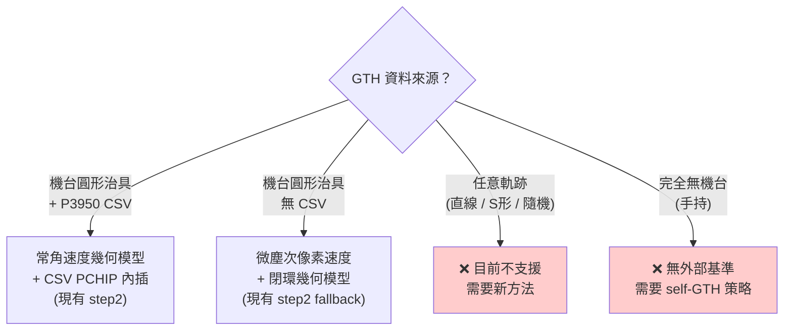
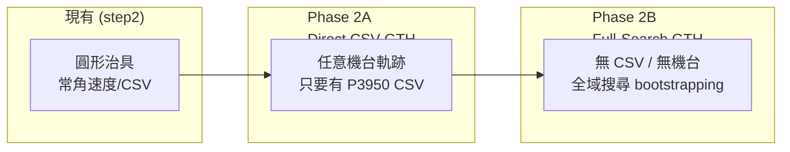
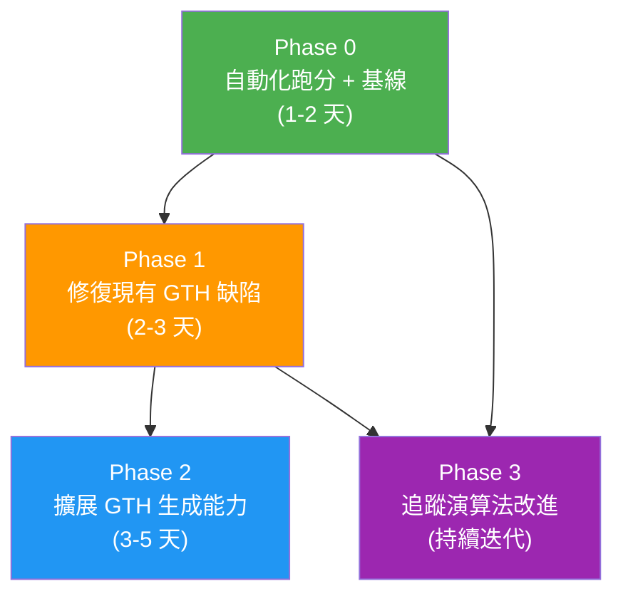

# ToG Tracker Ground Truth 生成與評分系統 — 全盤規劃

## 一、 專案現況盤點

### 已完成的基礎建設

| 資產 | 狀態 | 說明 |
|:---|:---:|:---|
| `tracker_core.py` 三模式追蹤器 | ✅ | Normal / Teacher / Ideal 完整實作 |
| `step1` FPN + 錨點分析 | ✅ | 時間中位數 FPN、Anchor Cluster 辨識 |
| `step2` GTH 重建（圓形治具） | ✅ | 支援 P3950 CSV 全序列 PCHIP 映射 |
| `step3` 三模式批次評估 | ✅ | ATE RMSE、In-Basin Rate、閉環漂移 |
| `run_pipeline.py` 一鍵管線 | ✅ | 自動歸檔至 `experiments/` |
| 9x9 Band-Pass 前處理 | ✅ | 已整合至 `preprocess_frame()` |
| 綜合評分公式 (100 分制) | ⚠️ 設計完成 | 尚未內建至自動管線輸出 |
| 多序列 / 跨資料集批次跑分 | ❌ | 目前逐一手動執行 |
| 非圓軌跡的 GTH 生成 | ❌ | `step2` 鎖死圓形幾何假設 |

### 現有實驗數據概覽

| 資料集 | 半徑 / 速度 | 表面 | 幀數 | Normal In-Basin | Teacher 介入率 | ATE RMSE |
|:---|:---|:---|:---:|:---:|:---:|:---:|
| Circle R0.1" / 0.005 IPS | 小圓 / 極慢 | Glass | ~5K | — | — | — |
| Circle R0.2" / 0.02 IPS (POS1-1) | 中圓 / 慢 | Glass | 5,373 | 80.3% | 6.7% (362次) | 15.35 px |
| Circle R0.2" / 0.02 IPS | 中圓 / 慢 | MousePad | ~5K | — | — | — |
| **FAMS Glass 1.0" / 4 IPS** | **大圓 / 快** | **Glass** | **12,000** | **15.9%** | **83.3% (9,999次!)** | **905.9 px** |

> [!IMPORTANT]
> **FAMS 大圓快速資料集** Normal Mode 幾乎完全失追 (In-Basin 僅 15.9%)，Teacher 介入達 83%。
> 這正是您描述的核心問題：**predicted position 錯了，真正的 best match 沒有落在 radius 裡，就追丟**。
> 該資料集的速度高 (每幀位移 ~1 px 以上)，3×3 搜尋窗口完全不足以覆蓋下一幀的真實特徵位置。

---

## 二、 問題核心釐清

您的問題可拆解為兩層：

### A. Ground Truth 的「產生方式」

### B. 有了 GTH 之後的「評分機制」

您已經設計了五大指標 + 100 分制公式，但尚未自動化成一鍵跑分工具。

---

## 三、 規劃路線圖

### Phase 0: 鞏固基礎 — 自動化跑分基線 (1–2 天)

> **目標**：讓每次演算法修改後能一鍵得到綜合分數，建立可追蹤的 baseline。

| 工作項目 | 具體內容 |
|:---|:---|
| **0-1. 實作綜合評分函數** | 在 `step3_three_mode_evaluator.py` 或新檔 `compute_score.py` 中，根據開發過程18的公式 $S = 30(1 - R_{TL}) + 30 B_{norm} + 20(1 - I_{teach}) + 20 \exp(-E_{ATE}/10)$，自動輸出 100 分制分數至 `step3_summary_report.json` |
| **0-2. 批次跑分腳本** | 建立 `run_benchmark_all.py`，自動遍歷 `experiments/` 下所有資料集的 `.raw` 檔，逐一執行完整 pipeline，匯出跨資料集的對比表 (Markdown + CSV) |
| **0-3. 建立 Git tag 基線** | `git tag baseline-v1.0`，鎖定當前程式碼與所有資料集的 baseline score |

### Phase 1: 強化 GTH 品質 — 解決現有 GTH 的缺陷 (2–3 天)

> [!WARNING]
> 目前 GTH 重建有以下已知缺陷需優先處理：

| 缺陷 | 影響 | 修復方向 |
|:---|:---|:---|
| **Ideal Mode ATE = 91 px 且 final drift = 91 px** (POS1-1) | Ideal Mode 理論上應是誤差最小的模式，但累積漂移嚴重 → GTH 與 Keyframe 管理可能有座標漂移 bug | 檢查 `IdealModeTracker` 的 `ref_gth` 更新邏輯，確認 Keyframe 更新時 `ref_gth` 是否正確同步至最新 GTH 位置 |
| **FAMS 資料集的 GTH 生成是否正確** | FAMS 1.0" / 4 IPS 是完全不同的速度量級 (速度高 ~20x)，step2 的物理參數校準是否適配 | 驗證 FAMS 資料集的 `omega`、`radius_px`、`speed_px_per_frame` 是否合理，必要時引入 CSV 路徑或手動參數覆寫 |
| **CSV 與 RAW 時間對齊精度** | PCHIP 內插假設 CSV 點均勻分佈在 `[t_start, t_end]`，若機台啟動/停止有加減速段，時間軸會有偏移 | 考慮用 SAD-based 交叉對齊或引入 timestamp 資訊 |

**具體工作項目：**

| 工作項目 | 具體內容 |
|:---|:---|
| **1-1. 修復 Ideal Mode 累積漂移** | 追查 POS1-1 Ideal Mode 91 px 漂移的根因。理論上 Ideal Mode 永遠以 GTH 為搜尋中心，不應有大漂移 → 懷疑是 Keyframe 更新時 `ref_gth` 沒有正確重設 |
| **1-2. FAMS 資料集適配** | 為 FAMS 大圓快速序列建立正確的 GTH，可能需要調整 `step2` 中的運動模型參數（omega、速度範圍）並驗證 step1 的 FPN 與 Anchor 是否在高速下仍適用 |
| **1-3. GTH 交叉驗證** | 用 Teacher Mode (近乎完美的 Ideal 追蹤) 的軌跡反推驗證 GTH 品質：若 Teacher Mode 的 ATE 顯著大於 Ideal Mode，代表 GTH 本身有偏差 |

### Phase 2: 擴展 GTH 生成能力 — 支援非圓軌跡 (3–5 天)

> **長期核心需求**：光學滑鼠在實際使用中不會只走圓形，需要直線、S 形、隨機軌跡的 GTH。

| 工作項目 | 具體內容 |
|:---|:---|
| **2-1. 通用 CSV-to-GTH 管線** | 將 `step2_gth_reconstructor.py` 重構為「圓形專用模式」與「通用 CSV 映射模式」兩個路徑。通用模式不假設圓形幾何，直接用 P3950 CSV 累積位移作為 GTH |
| **2-2. Full-Search Bootstrap GTH** | 當完全沒有外部 CSV 時，用「暴力全域搜尋」(如 $33 \times 33$ 或更大範圍) 在每幀搜尋最佳匹配，配合 Teacher Mode 的回溯校正，自舉出一條「最佳可能 GTH」。這條 GTH 雖非絕對精確，但足以作為 Normal Mode (3×3) 的相對基準 |
| **2-3. Multi-Keyframe GTH** | 用多條不同錨點的微塵軌跡互相交叉驗證，產生更精確的 GTH (類似 SLAM 的多特徵融合) |

### Phase 3: 追蹤演算法改進 — 解決 predicted position 失準問題 (持續迭代)

> [!NOTE]
> 這一部分是用 Phase 0–2 建立的 GTH 和評分系統來**驅動**演算法改進。

| 改進方向 | 核心思路 | 預期效果 |
|:---|:---|:---|
| **3-1. 動態搜尋半徑** | 當 SQUAL 低 (TL 區 / 速度高) 時自動擴大搜尋至 5×5 或 7×7，有特徵時縮回 3×3 節省運算 | 減少 FAMS 大圓的 Teacher 介入率 |
| **3-2. 改良速度預測器** | IIR 一階濾波器在急加速/急轉彎時慣性太大，考慮二階 Kalman Filter 或簡化版加速度模型 | 預測位置更準確，減少 basin breach |
| **3-3. 帶通濾波器硬體降階** | 按開發過程23的 4 階段路線：9×9 → 5×5 → 3×3 DoG → Multiplier-Free | 在維持分數的前提下減少 Line Buffer |
| **3-4. TL 區零速保護** | 偵測到連續 TL 區時凍結速度衰減，避免預測器「停滯歸零」後無法自恢復 | 減少從 TL 區過渡到 T 區時的初始介入 |

---

## 四、 建議的優先執行順序

> [!TIP]
> **建議立即啟動 Phase 0**（自動化跑分），因為它是所有後續改進的量化度量基礎。
> Phase 1 和 Phase 3 可以部分平行推進——修復 GTH 的同時也能開始嘗試動態搜尋半徑等演算法改進。

---

## 五、 我能立即幫您做的事

1. **Phase 0-1**：在 `step3_three_mode_evaluator.py` 中實作綜合評分公式，讓 `run_pipeline.py` 跑完後自動輸出 100 分制的 Tracking Scorecard
2. **Phase 0-2**：建立 `run_benchmark_all.py` 批次跑分工具，遍歷所有實驗資料集
3. **Phase 1-1**：診斷 Ideal Mode 在 POS1-1 上累積漂移 91 px 的根因
4. **Phase 1-2**：為 FAMS 大圓快速資料集修正 GTH 生成與評估

請問您想從哪一項開始？或者有其他優先順序的考量？
