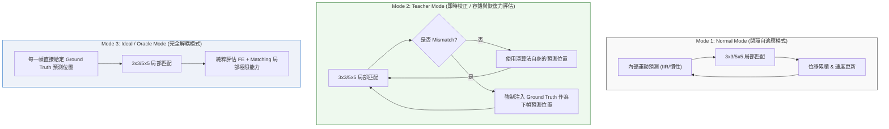

1. 我要開發光學滑鼠在玻璃上ToG。
ToG靠著在玻璃上的灰塵追蹤，但是難免會遇到沒有足夠的特徵能追蹤的情況。
所以，不只是feature extraction，還要跟trajectory prediction有關。
我需要一套有個ground truth的data。

滑鼠演算法的架構，feature extraction, matching, predicted position
matching只在predicted position的3x3 (或5x5)做matching。
而且是整個overlapped area做correlation

這時候predicted position就很重要，位置錯了，就找不到真正的位移了。

2. 合成dataset.
先產生一張大的底圖。
模擬底圖經過lens 投影到sensor 形成image.
每次位移，都產生一張image。
如此，位移是給定的，就知道位移的ground truth (gth) 了。

3. 當mismatch時，將gth 指定給下一個frame當做predicted position。
就不會發生，因為某次區域沒有特徵，mismatch，造成後面整串都出錯。
當演算法改良時，容易統計改良多少。

4. 這時，feature extraction/matching 就能獨立評估。
而且，trajectory prediction 也能獨立評估。

5. 我規劃三個mode
normal mode: 原來的演算法
teacher mode: 當mismatch時，提供gth 當做下個frame 的predicted position

6. 如何產生合成data
我有已錄製好的dataset，用這些合成一整張底圖。
此dataset可能含有fixed pattern noise，在合成之前，要先去掉。
去掉FPN，需要把沒有明顯特徵的影像，做average得到fpn map。
之後拿來合成的圖，都要先減掉fpn map

7. 所以，你應該要有
a. 合成的玻璃桌面底圖
b. 模擬的光學系統，把玻璃投影到sensor
c. 光學滑鼠演算法
d. 評價系統

8. 先前做過相關的演算法放在
C:\PROJECT\ai_mouse
C:\PROJECT\ON2401-1
C:\PROJECT\OT2501-cfpn

相關的ToG影像放在這裡
C:\Data\P3950_Raw_Image

先討論看看

---

Ran list directories in C:\PROJECT
Ran inspect project directory structures
Ran find python scripts in these projects
Ran list files in C:\Data\P3950_Raw_Image
Analyzed mouse_algo.py:L1-100
Analyzed mouse_algo.py:L101-250
Analyzed mouse_algo.py:L251-326
Analyzed tog_tracking_tool.py:L1-100
Analyzed tog_tracking_tool.py:L101-200
Analyzed tog_bk_builder.py:L1-87
Analyzed tog_bk_subtractor.py:L1-59
Analyzed optical_flow_sim.py:L1-100
Analyzed optical_flow_sim.py:L200-300
Analyzed optical_flow_sim.py:L301-380
Analyzed denoise.py:L1-60
Ran inspect files in C:\Data\P3950_Raw_Image
Analyzed raw2half.py:L1-50
Analyzed Release Note 20250925.txt:L1-2

這是一個非常精準且切中光學滑鼠在玻璃（Track-on-Glass, ToG）核心痛點的研發架構！

在光學滑鼠硬體設計中，算力與記憶體極度受限，通常只能在預測位置（Predicted Position）周圍做極小範圍的局部搜尋（例如 $3\times 3$ 或 $5\times 5$ 的匹配網格）。在這種硬體架構下，**「特徵稀疏/空洞」引發的連鎖失步（Error Cascading / Snowball Effect）** 是 ToG 追蹤崩潰的最主要原因：一旦中間某個區域沒有灰塵特徵，局部匹配產生錯誤位移，導致速度濾波器預測出錯誤的下一個位置，接著 $3\times 3$ 的搜尋窗口就徹底脫離真實位移的捕捉範圍，造成後續軌跡雪崩式發散。

您提出的 **「合成 Ground Truth 數據集 + Teacher Mode 解耦機制」**，非常漂亮地借鑑了機器學習領域的 *Teacher Forcing* 概念，能將「特徵提取/局部相關性匹配（FE & Matching）」與「運動軌跡預測（Trajectory Prediction）」兩個問題切開，進行獨立量化與除錯。

以下針對您提出的需求架構，結合現有專案庫（`ai_mouse`、`ON2401-1`、`OT2501-cfpn`）與 `P3950_Raw_Image` 的資產，為您梳理並討論整套系統的設計與落地方案：

---

### 一、 三個 Mode 的定義與解耦評估邏輯

您在第 5 點提到規劃三個 Mode，已列出 Normal 與 Teacher，我們建議第三個 Mode 規劃為 **Ideal / Oracle Mode（完全解耦模式）**，形成非常完整的評估閉環：

1. **Mode 1: Normal Mode（閉環自適應模式，真實韌體行為）**
   * **機制**：完全依靠演算法內部的運動學濾波器（如一階 IIR 速度濾波、加速度預測）推算預測位置。
   * **評估目的**：評估系統在真實世界的端到端（End-to-End）表現，統計發散率（Divergence Rate）與累積漂移（Accumulated Drift）。
2. **Mode 2: Teacher Mode（容錯與恢復力評估模式）**
   * **機制**：平時正常閉環運作；一旦發生 Mismatch（例如匹配誤差大於閾值、或位移偏離 Ground Truth 超過 $1\text{ px}$），在下一幀強制將 Ground Truth 指定為 `predicted position`。
   * **評估目的**：**阻斷連鎖錯誤**。測試演算法在度過無特徵的玻璃空洞區後，當灰塵特徵重新出現時，**需要幾幀才能拉回正確追蹤（Recovery Latency）**，並精確統計演算法改良後，Mismatch 的發生頻率降低了多少。
3. **Mode 3: Ideal / Oracle Mode（純特徵匹配評估模式）**
   * **機制**：不依賴任何軌跡預測，每一幀的 $3\times 3$ 或 $5\times 5$ 搜尋中心**永遠對準 Ground Truth 準確位置**。
   * **評估目的**：**將 Trajectory Prediction 完全抽離**。此時如果仍發生 Mismatch，代表完全是「特徵提取不良」、「灰塵對比度過低」或「局部相關性算法在雜訊下失效」。這能為 FE 與 Matching 定義出理論上的上限能力。

---

### 二、 四大核心模組架構設計

#### (a) 合成的玻璃桌面底圖 (Canvas Generator)
要產生高品質、可重現且無偽影的合成大底圖，我們有兩種互補的途徑：

1. **實測 Raw 影像拼接（Real Data Stitching with FPN Removal）**：
   * **FPN 去除**：直接沿用並擴充 `ai_mouse\tog_bk_builder.py` 的邏輯。利用 `P3950_Raw_Image`（如 20250925 的 0.5 ips 緩慢平移數據），自動篩選特徵量最低（$\text{mean}(|\text{feat}|) < \text{th}$ 且 $\max(|\text{feat}|) < \text{th}$）的無特徵畫面取平均，計算出高精度的 FPN / DSNU 模型，並在拼接前自每幀影像中減除。
   * **大圖拼接**：由於原始數據是以固定低速平移錄製，去噪後利用次像素對齊（Sub-pixel Registration）將數百至數千幀拼成一張超高解析度的玻璃微觀大底圖（例如 $2000 \times 2000$ 像素）。
2. **參數化程序合成（Procedural Synthetic Canvas，壓力測試專用）**：
   * 用 Poisson-Point Process 在大畫布上隨機灑落灰塵粒子（不同直徑、不同散射亮度、微小刮痕線段）。
   * **優勢**：可以**定量控制特徵密度（Feature Density）**，例如刻意製造「$100\text{ frames}$ 正常灰塵 $\to 30\text{ frames}$ 完全空白玻璃 $\to 100\text{ frames}$ 稀疏灰塵」，精確測試演算法在各級空洞長度下的容忍極限。

#### (b) 模擬光學與感測器成像系統 (Optical & Sensor Simulator)
從底圖採樣出 $36 \times 36$（或指定感測器尺寸）的虛擬影像：
* **次像素幾何投影**：給定任意運動軌跡方程式 $(x(t), y(t))$，採用雙三次（Bicubic）或微表面積分採樣投影到底圖。
* **光學點擴散與離焦（PSF / Optical Blur）**：模擬透鏡的 Airy disk 或高斯模糊（$\sigma_{\text{psf}}$），反映真實透鏡成像的軟度。
* **照明光斑與暗角（Lens Shading Profile）**：玻璃 ToG 的雷射/LED 通常有顯著的中心亮點與邊緣衰減，需疊加固定 Shading 遮罩。
* **感測器噪聲注入**：
  * 光子散粒噪聲（Shot Noise, Poisson 分佈）。
  * 讀出噪聲（Readout Noise, Gaussian 分佈）。
  * 加回真實的固定圖樣噪聲（FPN Map），檢驗演算法的去 FPN 與抗噪能力。
* **量化**：模擬 8-bit ADC 取整與飽和。

#### (c) 光學滑鼠演算法核心 (Mouse Algorithm Pipeline)
對齊現有 `ai_mouse\tog_tracking_tool.py` 與 `ON2401-1\optical_flow_sim.py` 的核心架構：
* **Feature Extraction (FE)**：支援多種前端核心（Box2 平滑 $\to$ Saddle3 $\to$ Lap4r 疊加、FAST Corner 篩選、DC offset 消除、4-bit 量化截斷）。
* **Trajectory Prediction**：
  * 1st-order IIR 速度平滑器：$V_{k} = \alpha V_{\text{inst}} + (1 - \alpha) V_{k-1}$。
  * 2nd-order 加速度預測模型（如 `ON2401-1` 中的二階預測）。
  * 預測目標：輸出下幀整數候選中心 $(p_x, p_y)$。
* **Matching & Subpixel Estimation**：
  * 在 $(p_x, p_y)$ 周圍建立 $3\times 3$（或 $5\times 5$）搜尋矩陣。
  * 重疊區域相關度計算（ZNCC 或 Area-compensated CORR / SAD）。
  * 拋物線極值內插（Parabolic Interpolation）達到次像素精度（如 1/16 或 1/128 subpixel）。
* **信心指標與 Mismatch 判定（Confidence / SQUAL）**：
  * 表面峰值尖銳度（Peak-to-Floor Ratio / Peak-to-Secondary Ratio）。
  * 模板自身方差（SQUAL）。

#### (d) 評價與 Benchmark 系統 (Evaluation System)
* **誤差指標**：
  * 瞬時誤差：$e_t = \sqrt{(\Delta x_t - \Delta x_{\text{gth}})^2 + (\Delta y_t - \Delta y_{\text{gth}})^2}$
  * 累積軌跡誤差（ATE）與 相對位移誤差（RPE）。
* **統計與對比矩陣**：
  * **Mismatch 次數與發散率**：Normal Mode vs. Teacher Mode 的累積失步次數。
  * **恢復延遲（Recovery Delay）**：進入空洞區後失步，在重新遇到特徵時，演算法需要幾幀恢復追蹤。
  * **特徵密度耐受度曲線**：繪製「特徵密度（灰塵覆蓋率） vs. 追蹤失步率」的曲線，量化新演算法的進步幅度。

---

### 三、 現有程式庫資產與盤點

您提到的三個現有目錄與數據庫內容完整，我們完全可以直接站在這些既有基礎上快速建構：

| 專案 / 路徑 | 現有可用模組與重要邏輯 |
| :--- | :--- |
| **`C:\PROJECT\ai_mouse`** | • `tog_bk_builder.py`：利用 Textureless 閥值（`th_mean`, `th_max`）自動平均提取 FPN 背景模型。 • `tog_bk_subtractor.py`：背景減除與去噪。 • `tog_tracking_tool.py`：標準 $3\times 3$ 局部搜尋、Parabolic 次像素內插、SAD/CORR 面積補償、IIR 速度預測。 • `mouse_algo.py`：Box2+Saddle+Lap4r 串聯特徵提取。 |
| **`C:\PROJECT\ON2401-1`** | • `optical_flow_sim.py`：完整的 `SensorConfig` 參數化架構、定點數運算、二階運動預測（`a_x_filt_q8`）、信心度閥值控制、動態 AGC 與背景光抑制（BGS）。 |
| **`C:\PROJECT\OT2501-cfpn`** | • `denoise.py`：更深入的 Column FPN 去噪、壞點補償（DPC）與 Optical Black（OB）處理機制。 |
| **`C:\Data\P3950_Raw_Image`** | • 包含 PAW3950 在玻璃表面實錄的 $36\times 36$ OPNI 格式 Raw 檔（例如 0.5 ips 直線、圓形軌跡、Cleaner Glass 等），是提煉真實玻璃微塵特徵與 FPN 的絕佳原料。 |

---

### 四、 建議先確認的討論細節

在我們開始撰寫架構程式碼之前，想先與您確認幾個設計偏好與細節：

1. **第三個 Mode 的定義**：
   * 是否同意將第 3 個 Mode 定義為 **Ideal / Oracle Mode（搜尋中心永遠鎖定 Ground Truth 預測）**，用來完全隔離運動濾波器誤差，專門測試「特徵提取與局部匹配極限」？
2. **底圖生成的偏好**：
   * 您希望第一階段**以「真實實錄數據拼貼的大圖」為主**，還是**以「參數化隨機產生灰塵/刮痕特徵的畫布」為主**？（建議：系統設計成兩者皆支援，先用參數化畫布驗證 pipeline 與空洞測試，再載入真實拼接大圖）。
3. **Mismatch 的判定準則**：
   * 在 Teacher Mode 中，觸發「判定為 Mismatch 並注入 Ground Truth」的條件，您偏好由：
     * (A) **演算法內部自檢**（例如 Matching Score / SQUAL 低於某閥值）？
     * (B) **外部客觀判定**（當演算法回傳位移與 Ground Truth 誤差大於 $N$ 個 pixel 時視為 Mismatch）？
     * （實務上建議兩者都記錄：(A) 測試演算法自知能力，(B) 作為 Teacher Mode 強制注入的觸發器）。
4. **搜尋範圍與感測器解析度**：
   * 預設搜尋範圍是否固定為 $3\times 3$（`search_radius = 1`），還是需要支援切換到 $5\times 5$？
   * 感測器尺寸是否先固定為標準的 $36 \times 36$？

請告訴我您的想法，我們可以先聚焦在核心架構的規格定案，接著一步步推進！