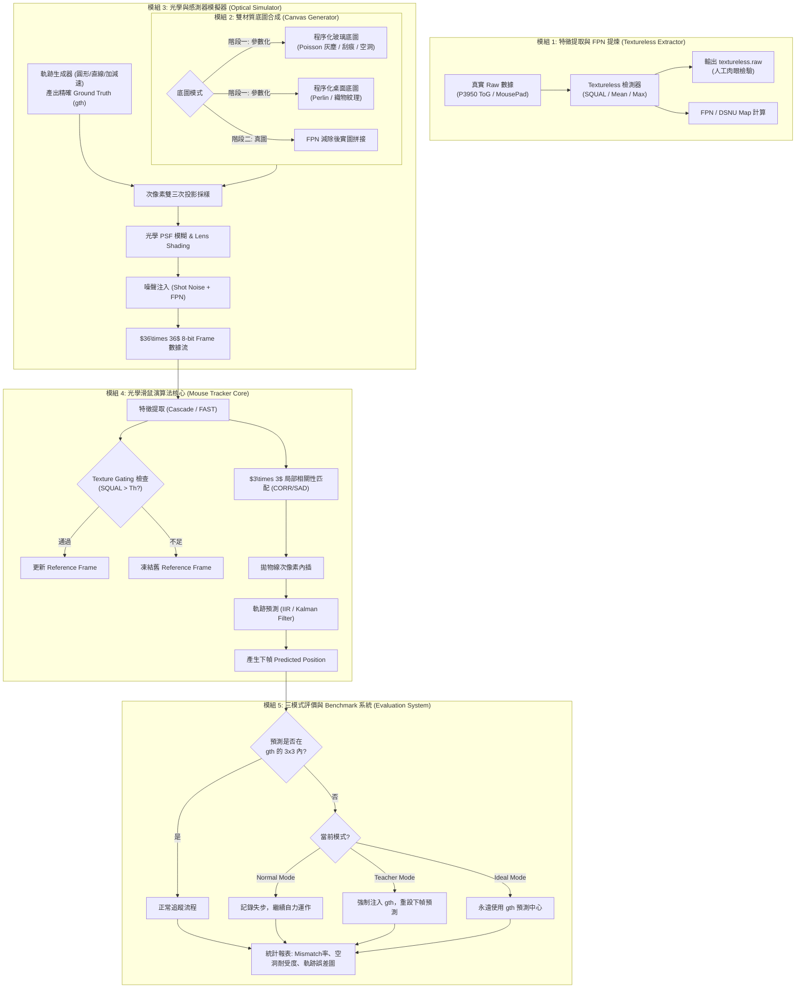

## 問題
  1. OK
  2. 底圖先參數化，再真圖 
  3. 只要讓predicted position 落在gth 的3x3內，就有機會在下一個frame被找到，這就算是正確的位移。
     不是看current dx,dy的值，而是用預估的位置，來判定，是否讓gth介入
  4. 先採用36x36，3x3。參數化，以利後面的修改。

其他的問題：

  a. 同時要兼顧ToG與一般桌面，以下是一般桌面的dataset.
    C:\Data\testPattern玻璃\Circle_R0.2inch_IPS0.02_MousePad

  b. 抽取出來的textureless frame 另外存成raw檔，以供我肉眼檢視。
  c. 合成影像，不止玻璃表面，還需要一般的桌面
  d. 抽取textureless模組，合成底圖模組，產生dataset(經過光學系統)模組，滑鼠演算法模組，要記得區分好。
  e. 我的經驗是，簡單的trajectory prediction 應該是不夠的。可能要考慮kalman filter，也可能要加入一些exception，當mismatch時，啟動類似full search的功能，重新找回夠準的predicted position。
  但是啟動full search 會讓某個frame 的處理時間太長，所以要有取捨。可能要像底下的patents一樣，
  "C:\DOC\光學滑鼠\pixart\skating\US9684384B2 skating 當lift之後放下時，啟動sken=1，把search range擴大成寬9高5，分成ABCDE區。連續20幀在同一區才算成功.pdf"
  或者是每個frame只做少數幾個matching，不拖累pipeline，用多個frame找到夠準的predicted position. 
  或者是，找到影像上的孤立點(在玻璃上只剩幾個灰塵，應該很容易被identify出來)，用這些直接找到位移。
  還有，在update ref frame的時候，可能要考慮，此frame是否夠多texture。

  f. 最後，我用的名詞，可能不夠精準，若你有合適的，就提出來。

先列出你的計劃。

---

Ran check testPattern玻璃 directory
Ran check skating patent document

這是一套極具工程深度且架構清晰的規劃。您的幾項洞見（特別是**「以 Predicted Position 是否落在 gth 的 $3\times 3$ 捕捉範圍內作為 Mismatch 與介入判定」**，以及**「Ref Frame 更新時必須具備特徵門檻防毒機制」**）完全切中了光學導航感測器（Optical Navigation Sensor）在硬體受限下的核心本質。

以下為您梳理專業術語定義，並列出模組化開發與驗證的完整執行計劃：

---

### 一、 專業術語對齊與規格定義 (Terminology Alignment)

為了後續討論、代碼命名與專利/文獻對接更精確，我們建議統一採用以下標準術語：

| 討論名詞 | 建議標準術語 (英文 / 中文) | 定義與說明 |
| :--- | :--- | :--- |
| **預測能否抓到位移** | **Capture Basin / Pull-in Range** （捕捉範圍 / 收斂吸引域） | 當預測位置 $(\hat{x}, \hat{y})$ 與真實位置 $(x_{\text{gth}}, y_{\text{gth}})$ 誤差在 $\le 1.0\text{ px}$ 內（即落在 $3\times 3$ 網格中心內），局部匹配即有物理能力捕捉到真值。超過此範圍即判定為 **Prediction Out-of-Basin (失步)**。 |
| **Teacher Mode 介入** | **Teacher-Forcing Injection** （教師強制注入校正） | 當偵測到下幀預測位置脫離 Capture Basin 時，外部即時注入 Ground Truth，阻斷連鎖崩潰。 |
| **無特徵畫面抽檢** | **Textureless Frame Extraction / DSNU Profiling** | 提取無紋理幀以計算暗電流不均勻度（DSNU/FPN），並輸出 Raw 供人工檢視。 |
| **Ref Frame 更新門檻** | **Texture-Gated Reference Update** （特徵門檻鍵幀更新） | 只有當前幀的特徵質量（SQUAL）高於安全閥值時才允許更新 Reference Frame，**嚴格杜絕「用空白玻璃污染參考幀」**。 |
| **灰塵孤立點追蹤** | **Sparse Star-Tracker Matching** （星圖質心匹配） | 玻璃表面僅剩微量灰塵點時，跳過全圖相關性，直接以連通域質心進行點特徵關聯。 |
| **分幀搜尋例外機制** | **Budget-Constrained Time-Sliced Search** （時間片預算擴展搜尋） | 如專利 US9684384B2，為避免單幀運算暴增拖累 Pipeline，將擴展搜尋範圍切分成數幀分攤計算。 |

---

### 二、 系統模組架構圖 (System Architecture)

各模組保持高內聚、低耦合，介面完全參數化（預設支援 $36\times 36$ 感測器、可設定 $3\times 3$ 或 $5\times 5$ 搜尋）：

---

### 三、 執行階段計劃 (Implementation Roadmap)

我們按照「先底層模組與參數化驗證，再整合演算法與真圖，最後進階例外模式」的節奏推進：

#### 【Phase 1】獨立模組 (1)：Textureless 幀抽取與 FPN 提煉
* **目標**：
  1. 建立 `TexturelessExtractor`，輸入 `C:\Data\P3950_Raw_Image` 與 `C:\Data\testPattern玻璃` 中的 Raw 檔。
  2. 根據特徵強度雙門檻（$\text{mean}(|\text{feat}|) < \text{th}_{\text{mean}}$ 與 $\max(|\text{feat}|) < \text{th}_{\text{max}}$）篩選純玻璃畫面。
  3. **產出 `textureless_extracted.raw`**：符合 OPNI 格式（128-byte header），讓您能用既有的 raw viewer 直接開啟肉眼檢視確認。
  4. 計算平均導出高訊噪比的 `fpn_map.npy` / `fpn_map.raw`。

#### 【Phase 2】獨立模組 (2)：參數化雙材質底圖合成器 (Procedural Canvas)
* **目標**：
  1. **玻璃表面（ToG Mode）**：
     * 支援可配置的灰塵密度（Particles per $\text{mm}^2$）、粒子尺寸分佈、長條刮痕（Scratches）。
     * **關鍵功能**：可程式化置入「特徵空洞區（Featureless Gap）」（例如長度 $N$ 像素的完全純淨玻璃），用於精確測試失步與恢復極限。
  2. **一般桌面（MousePad Mode）**：
     * 採用合成高頻織物紋理（Perlin 噪聲疊加方向性編織晶格），提供豐富且均勻的特徵。
  3. 底圖尺寸預設 $2000 \times 2000$，保留像素級座標映射關係。

#### 【Phase 3】獨立模組 (3)：光學與感測器投影模擬器 (Optical Simulator)
* **目標**：
  1. **輸入**：底圖物件 + 預設運動軌跡方程式（支援等速直線、正弦波加減速、圓形軌跡 `Circle_R0.2inch` 等）。
  2. **光學與感測器運算**：
     * 次像素雙三次插值採樣（$36\times 36$）。
     * 點擴散函數（高斯 PSF 卷積，模擬光學軟度）。
     * 透鏡暗角與照明場衰減（Lens Shading Profile）。
     * 疊加光子散粒噪聲（Shot Noise）以及 Phase 1 提煉的真實 FPN。
     * 量化至 8-bit uint8。
  3. **輸出**：逐幀影像數據流，每一幀附帶嚴格的數學真值 `(gth_x, gth_y, gth_dx, gth_dy)`。

#### 【Phase 4】獨立模組 (4)：光學滑鼠核心演算法（含預測與 Ref 門檻控制）
* **目標**：
  1. **特徵提取**：支援 Cascade 卷積（Box2 $\to$ Saddle3 $\to$ Lap4r）與 4-bit 量化。
  2. **特徵門檻鍵幀管理（Texture-Gated Keyframe Engine）**：
     * 計算當前幀特徵能量（SQUAL）。若小於安全門檻，**凍結 Reference Frame**，禁止更新，避免無特徵幀污染。
  3. **匹配核心**：
     * 以預測位置為中心，在 $3\times 3$ 網格執行 Area-compensated Correlation / SAD。
     * 拋物線極值內插（Parabolic Interpolation），輸出次像素位移。
  4. **運動預測器（支援可抽換介面）**：
     * 基礎版：一階 IIR 速度濾波器。
     * 進階版：二階 Kalman Filter（狀態向量包含位置、速度、加速度；當 SQUAL 變低時自動提高測量噪聲協方差 $R$，依靠慣性導航平穩滑過空洞）。

#### 【Phase 5】獨立模組 (5)：三模式評價與 Benchmark 框架
* **目標**：
  1. **落實捕捉範圍（Capture Basin）判定準則**：
     $$\text{In-Basin} \iff \max(|\text{round}(\hat{x}_t) - x_{\text{gth}, t}|, |\text{round}(\hat{y}_t) - y_{\text{gth}, t}|) \le 1$$
     若不滿足，即判定此幀預測失步。
  2. **三模式運行引擎**：
     * **Normal Mode**：內部自力運行，記錄失步次數與最終累積漂移。
     * **Teacher Mode**：當失步時，強制將下幀預測位置重設為 $P_{\text{gth}}(t+1)$，統計 Mismatch 事件分佈與「遇到特徵後的恢復延遲（Recovery Latency）」。
     * **Ideal Mode**：永遠使用 Ground Truth 預測，評估特徵匹配本身的純極限能力。
  3. **輸出分析圖表**：
     * 軌跡重疊圖（Normal vs Teacher vs Ideal vs GTH）。
     * 誤差時序曲線圖（包含無特徵空洞區的視覺標記區間）。
     * 統計報告（Mismatch 次數、恢復平均延遲幀數、次像素 RMSE）。

#### 【Phase 6】進階例外處理與真實數據對接 (Advanced Recovery & Real Data)
* **目標**：
  1. **專利型分幀擴展搜尋（US9684384B2 啟發）**：
     * 當進入低信心度或失步時，啟動 Budget-Constrained 搜尋，每幀只額外測試 $2\sim 3$ 個偏移點，分散於多個 frame 逐步尋回正確預測位置。
  2. **玻璃專用星圖質心匹配（Star-Tracker Centroid Matching）**：
     * 針對玻璃極端稀疏微塵，實現孤立亮點提取與質心關聯匹配。
  3. **真實 Raw 拼接大底圖**：
     * 將 Phase 1 去除 FPN 後的實錄玻璃數據與 MousePad 數據，縫合成超大實景畫布，跑入相同 Benchmark 驗證。

---

### 四、 下一步行動

若您確認此計劃方向與切入順序符合您的預期，我們下一步將立即開始：
**建立標準專案結構，並實作【Phase 1】：開發 Textureless Extractor，從 `P3950_Raw_Image` 抽取無特徵幀輸出為獨立的 `.raw` 檔案供您肉眼檢視，同時產出第一版 FPN Map。**

請確認是否可以依此計劃開始推進？