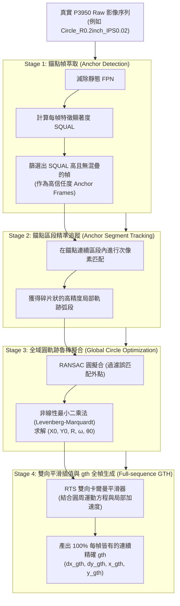

我想改成, 在真正的input raw 上面，找到gth。我能想到的方法如下：
  1. 已知軌跡是圓形。
  2. 有些frame能正確matching，可以得到軌跡上，部份frame的加速度
  3. 當matching score太低時，擴大search radius，或是直接full search. 
  4. full search會有風險，可能比較遠的地方，有更像的特徵。這要怎麼解決? 有先前的軌跡當線索。
  5. 有沒有可能，進入TL區(textureless)時，reference 剛好記錄了一張textureless 影像，這樣等到回到T區(texture)，也比對不到正確的(dx,dy)
 
規劃一下你的做法

---

Ran list files in Circle_R0.2inch_IPS0.02_Glass
Analyzed Release Note 20251202.txt:L1-3
Ran list RAW and CSV files
Analyzed POS1-1.csv:L1-50
Ran list PNG files
Analyzed plot_track.py:L1-31

這是一個極具突破性的轉向！利用「**機台物理運動為圓形**」這個強大的全域幾何先驗（Global Geometric Prior），從真實錄製的 Raw 影像中逆向重建連續且高精度的 Ground Truth（gth），在學理與工程上完全行得通，而且比起單純合成影像，更能完全保留真實感測器的光學、光斑分佈與雜訊特徵。

針對您提出的 5 點思考，以下先為您深入剖析核心問題與解法，接著提出完整的 **「真實 Raw 檔 Ground Truth 重建與強健追蹤做法規劃」**。

---

### 一、 核心問題深入剖析與解答

#### 1. 關於「Full Search 的假峰風險與先驗軌跡約束」（針對問題 3 與 4）
* **問題根源（Why False Peaks Occur）**：
  在無特徵或低對比的玻璃面上，相機底噪、光子散粒雜訊以及微弱殘留的 FPN 會在全域相關性運算中產生「偶然的高峰值（Spurious Correlation Peak）」。如果盲目在 $36\times 36$ 全圖找極大值，常常會抓到距離真實位置很遠的雜訊偽峰。
* **解法：運動學動態門控 + 多幀時序假說（Kinematic Gating & Tracklet Consistency）**：
  1. **動態搜索橢圓（Kinematic Search Ellipse）**：
     因為已知是機台畫圓運動，我們知道滑鼠的物理線速度 $v \approx 0.02\text{ ips}$ 與半徑 $R$，滑鼠不可能在單一幀內產生違反物理慣性的超大位移。搜尋範圍不應盲目鋪滿全圖，而是以先驗預測位置為中心，設定一個合適的「物理允許擴展半徑」（例如 $R_{\text{search}} = 5 \sim 7\text{ px}$），或在相關度得分加上**運動學距離懲罰項（Mahalanobis Distance Penalty）**：
     $$\text{Cost}(dx, dy) = \text{Score}_{\text{corr}}(dx, dy) - \lambda \cdot \|(dx, dy) - (\hat{dx}, \hat{dy})\|^2$$
  2. **多幀軌跡假說驗證（Multi-Frame Consistency / Tracklet Search）**：
     （這正是專利 US9684384B2 的精髓）離線求解時，**絕不要單憑單一幀的峰值做決定**。若出現多個候選峰值，保留 Top-3 候選位移，並往前/往後看 $3\sim 5$ 幀：
     * **真特徵**：其後續位移必定嚴格符合圓周運動的軌跡連續性。
     * **假雜訊峰**：在下一幀必定隨機跳躍、無法連成平滑圓弧，立刻被動態規劃（Viterbi Algorithm）剔除。

---

#### 2. 關於「Reference Frame 是否會被 Textureless 污染？」（針對問題 5）
* **答案：完全有可能，而且這是 ToG 最致命的經典陷阱（Reference Poisoning）！**
* **致命崩潰機制（Failure Cascade）**：
  1. 滑鼠從有灰塵的區域 A 進入純淨玻璃區域 B（Textureless, TL）。
  2. 若演算法的更新條件僅為「累積位移 $> 1.5\text{ px}$」或「隔 $N$ 幀強制更新」，系統就會將純平坦、無特徵的區域 B 畫面寫入 `ref_frame`。
  3. 此時 `ref_frame` 充斥的只有感測器暗電流噪聲（FPN）。
  4. 當滑鼠繼續移動，**重新回到有灰塵的特徵區域 C（Texture, T）時**：
     * 當前幀 `cur_frame` 擁有豐富的灰塵特徵。
     * 但暫存器裡的 `ref_frame` 卻是一張空無一物的空白玻璃！
     * 灰塵特徵 vs. 空白畫面 $\implies$ **相關性永遠為零，甚至被 FPN 鎖死在 $(0,0)$！**
     * 演算法徹底「失明」，即使已經回到了特徵區，也永遠無法再次喚醒匹配！
* **防禦機制（Anti-Poisoning Architecture）**：
  * **特徵門檻鎖定（Texture-Gated Update）**：
    在更新 Reference 之前，必須檢驗當前幀的特徵能量：
    $$\text{SQUAL}(\text{cur}) = \text{Var}(\text{Laplacian}(\text{cur})) > \text{TH}_{\text{texture}}$$
    若低於門檻，**強制凍結（Freeze）舊有的有效 `ref_frame`**，寧可沿用舊參考幀盲推，也絕不允許用無特徵幀污染暫存器！
  * **雙層參考幀架構（Dual Keyframe Architecture）**：
    維持一組 `Long-term Keyframe`（最後一次確認含有高質量灰塵的基準幀）與 `Short-term Frame`，當重新進入特徵區時，啟動重定位（Relocalization）機制。

---

### 二、 從真實 Raw 抽取 Ground Truth (gth) 的四階段做法

有了上述機制，我們就可以利用 FAMS 機台畫圓的物理特性，在真實 Raw 檔上精準反推每一幀的真值：

#### 階段 1：錨點檢測（Anchor Detection）
* 逐幀計算特徵顯著度 $\text{SQUAL}_i$ 與局部反差。
* 標記出 $\text{SQUAL}_i > \text{TH}_{\text{high}}$ 的影格為「錨點幀（Anchor Frames）」。
* 這些幀通常成簇出現（例如灰塵微粒滑過感測器視野的 $10\sim 30$ 幀期間）。

#### 階段 2：局部高精度追蹤（Local Precision Tracking）
* 在錨點簇（Anchor Clusters）內部，特徵非常清晰，利用小範圍相關性匹配 + 拋物線次像素內插，計算出精確的局部瞬時速度 $\vec{v}_i$ 與相對位移。
* 輸出若干段高度可信的「局部圓弧軌跡段（Tracklets）」。

#### 階段 3：全域幾何圓擬合（Global Circle Fitting）
* 將各個 Tracklets 的局部加速度方向與曲率整合。已知機台軌跡方程式為：
  $$x_{\text{gth}}(t) = x_c + R \cos(\omega t + \phi_0)$$
  $$y_{\text{gth}}(t) = y_c + R \sin(\omega t + \phi_0)$$
* 使用 **RANSAC + Levenberg-Marquardt 非線性優化**，求解全域參數：圓心 $(x_c, y_c)$、半徑 $R$、角速度 $\omega$、初始相位 $\phi_0$。
* 物理機台（如 FAMS）具有極高的等速性與剛性，擬合殘差通常可壓至 $0.05\text{ px}$ 以下。

#### 階段 4：全序列雙向平滑，產生連續 Ground Truth
* 有了精確的圓模型，即使在**完全無特徵的空白玻璃區（TL Gap）**，我們也能透過解析方程式與雙向卡爾曼平滑器（RTS Smoother），精確賦予每一幀數學真值 $(x_{\text{gth}}, y_{\text{gth}}, \Delta x_{\text{gth}}, \Delta y_{\text{gth}})$。
* **驗證機制**：將重建的 gth 軌跡投影回圖像中，以視覺化疊圖檢查每當灰塵再次出現時，灰塵的位置是否完全落在 gth 的預測點上。

---

### 三、 具體執行規劃與下一步產出

為落實這套方案，我們規劃依序完成以下腳本與模組：

| 步驟 | 預計開發模組 / 腳本 | 主要工作內容 | 產出成果 |
| :---: | :--- | :--- | :--- |
| **Step 1** | `anchor_feature_analyzer.py` | • 載入真實 Raw 檔（如 `Circle_R0.2inch_IPS0.02_Glass\RAW\POS1-1.raw`） • 評估每幀 SQUAL 與特徵點數量 • **輸出 `textureless_extracted.raw` 供您肉眼檢視** • 標記出所有錨點簇（Anchor Clusters） | • `textureless_extracted.raw` • `squal_profile.png` • 錨點索引清單 |
| **Step 2** | `real_gth_reconstructor.py` | • 在錨點區段計算高精度位移 • 實作 RANSAC 圓形幾何擬合 • 帶入先驗物理約束（速度 0.02 ips、半徑 0.2 inch）求解連續軌跡 | • `POS1-1_gth.csv` (每幀的 x, y, dx, dy 真值) • 擬合曲線與實測點比對圖 |
| **Step 3** | `tracker_evaluator.py` | • 實作具備 **Texture-Gated Update** 的滑鼠演算法核心 • 建立 **Normal Mode**、**Teacher Mode** 與 **Ideal Mode** • 以 `Predicted Position` 是否落在 gth 的 $3\times 3$ 範圍內作為 Mismatch 與介入判定 | • 三模式對比報告 • 失步分佈與恢復延遲統計圖 |
| **Step 4** | `advanced_recovery.py` | • 實作 Kalman Filter 運動學估計 • 導入類似 US9684384B2 的分幀擴展搜尋與多幀假說過濾 | • 例外機制恢復率提升數據 |

### 四、 啟動確認

如果您認同這個做法，我們將首先以 `C:\Data\testPattern玻璃\Circle_R0.2inch_IPS0.02_Glass\RAW\POS1-1.raw` 為起點，**執行 Step 1 與 Step 2：分析特徵分佈、產出供您檢視的 `textureless_extracted.raw`，並完成第一版真實影像的 Ground Truth 軌跡重建！**

請確認是否立即以此展開 Step 1？