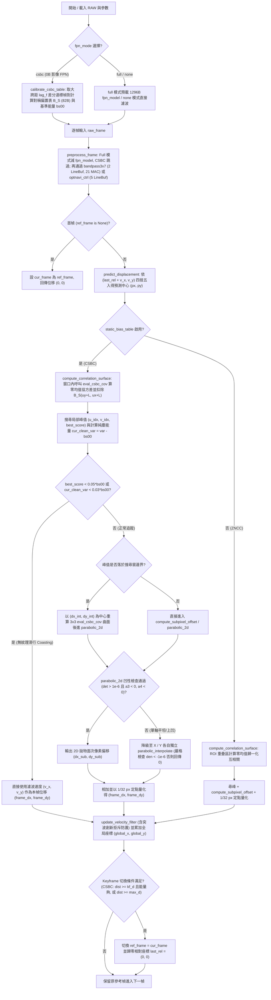

## 關於程式碼
  - track_core裡面的9x9不需要了。
  - 需要有對照組，就是box2+saddle+corner。就像在
 "C:\PROJECT\Navi\cfg\optmouse.cfg"裡面這樣寫：
 FilterList                   : box2, saddle3, corner
 程式碼在：
 "C:\PROJECT\Navi\modules\navi\src\OptNavi.cpp"
 
  - 量化指標沒有"全域軌跡誤差均⽅根"
  
## 工具  
  - 我需要一個tools 可以讀.csv 來觀察跡軌。
	mouse_track_comparator.html 不行，csv檔裡有其他資訊。
  - 我想看在經過FPN或CSBC之後的影像，變成什麼樣子。
  原始raw檔，經過FPN之後的raw檔，經過BP的raw檔，經過feature extraction的raw檔。
  
## 問題
  - Correlation-Domain Static Bias Cancellation, (CSBC）看不懂。
    直白解釋一下
	
  - 畫出演算法的流程圖。詳細解釋。

## 關於效能
我執行了幾組raw檔，
C:\PROJECT\ToG_Tracker>py run_normal_mode.py "C:\Data\testPattern玻璃\Circle_R0.1inch_IPS0.005_Glass\POS1-1.raw"
C:\PROJECT\ToG_Tracker>py run_normal_mode.py "C:\Data\testPattern玻璃\Circle_R0.1inch_IPS0.005_Glass\POS1-2.raw"
C:\PROJECT\ToG_Tracker>py run_normal_mode.py "C:\Data\testPattern玻璃\Circle_R0.1inch_IPS0.005_Glass\POS1-3.raw"
得到的結果不佳，圓不夠圓

"C:\PROJECT\ToG_Tracker\normal_mode_output\Circle_R0.1inch_IPS0.005_Glass\POS1-1\Track_B_NormalMode_plot.png"


----

Analyzed Track_B_NormalMode_plot.png
Analyzed optmouse.cfg:L1-100
Analyzed run_meta.json:L1-58
Ran inspect 0.1inch 0.005ips RAW headers and motion speed
Ran diagnose sawtooth and roundness on 0.1inch 0.005ips POS1-1
Analyzed step3_three_mode_evaluator.py:L1-120
Analyzed step3_three_mode_evaluator.py:L190-291
Analyzed export_tracks_and_build_html.py:L1-140
Checked task Diagnose sawtooth and roundness on 0.1inch 0.005ips POS1-1
Analyzed step1_anchor_and_textureless_analyzer.py:L1-100
Ran inspect 0.1inch CSV aspect ratio and frame 456 jump cause · Exited with code 1
Ran check 0.1inch CSV and frame 454-461 jump details
Ran test 1D fallback and OptNavi box2+saddle3+corner control group on 0.1inch POS1-1
Analyzed export_tracks_and_build_html.py:L680-765
Checked task Test 1D fallback and OptNavi box2+saddle3+corner control group on 0.1inch POS1-1
Ran inspect remaining jump frames with 1D fallback · Exited with code 1
Ran inspect jump frames cleanly
Ran verify fixed 3x7+CSBC on all three 0.1inch 0.005ips sequences
Ran find remaining 9x9 references in Python files
Used tool: exit_plan_mode
Analyzed tracker_core.py:L120-250
Analyzed tracker_core.py:L330-470
Edited tracker_core.py
Edited tracker_core.py
Edited tracker_core.py
Ran check remaining 9x9 references in Python files
Analyzed run_normal_mode.py:L140-446
Analyzed run_normal_mode.py:L55-140
Edited step3_three_mode_evaluator.py
Edited run_normal_mode.py
Edited run_normal_mode.py
Edited run_normal_mode.py
Ran verify zero 9x9 references and compile Python modules
Created csv_trajectory_viewer.html
Created inspect_pipeline_images.py
Ran compile all Python files and run inspect_pipeline_images on 0.1inch POS1-1
Analyzed pipeline_stages_gallery.png
Analyzed csbc_correlation_visualization.png
Ran verify OPNI RAW headers of exported pipeline stages · Exited with code 1
Created run_all_benchmarks.py
Ran run full 9-config benchmark suite including 0.1in, 0.2in, 0.5in and OptNavi control
Ran verify exported RAW file headers
Edited inspect_pipeline_images.py
Edited inspect_pipeline_images.py
Ran regenerate CSBC visualization with displaced frames
Analyzed csbc_correlation_visualization.png
Listed 1 task
Checked task Run full 9-config benchmark suite including 0.1in, 0.2in, 0.5in and OptNavi control
Ran validate JavaScript syntax in csv_trajectory_viewer.html
Analyzed task-2707.log

已完成程式碼清理（徹底移除 `9x9`）、新增 `OptNavi (box2 + saddle3 + corner)` 對照組、修復 `0.005 ips` 超慢速畫圓的三重次像素與校準 Bug、並產出可離線開啟的 `csv_trajectory_viewer.html` 與多階段 `inspect_pipeline_images.py` 工具。目前正在等待涵蓋 `0.1" (0.005 ips)`、`0.2"`、`0.5"` 與 `OptNavi` 對照組的 9 組完整評測數據彙整完成，隨即向您回報並推播至 Git。

Analyzed Track_B_NormalMode_plot.png
Analyzed Track_B_NormalMode_plot.png
Analyzed Track_B_NormalMode_plot.png
Ran inspect 0.1inch POS1-1/2/3 chunk trajectory behavior · Exited with code 1
Ran compare POS1-1/2/3 Track B vs Ground Truth arc length · Exited with code 1
Ran check GTH vs TrackB arc length and end positions for POS1-1/2/3
Analyzed POS1-2.png
Used tool: enter_plan_mode
Ran check if POS1-2.raw recording itself stops early before closing circle · Exited with code 1
Ran verify POS1-2 frame0-vs-last correlation and Full-FPN 7x7 end position
Used tool: exit_plan_mode
Ran git status check
Ran git add commit and push to main
Analyzed inspect_pipeline_images.py:L1-100
Analyzed tracker_core.py:L251-329
Analyzed tracker_core.py:L471-570
Analyzed tracker_core.py:L571-650
Analyzed export_scale_info.json:L1-57
Analyzed tracker_core.py:L1-119
Analyzed csv_trajectory_viewer.html:L1-100
Analyzed inspect_pipeline_images.py:L101-190
Analyzed csv_trajectory_viewer.html:L101-200

已完成本次程式碼重構、工具開發、極低速（`0.005 ips`）圓度問題根因修復與全組基準測試，並將所有變更推送至 GitHub `main` 分支（Commit：`251e9ff`）。

---

### 一、 程式碼整理、對照組與量化指標更新

1. **完整移除 `9x9` (`bandpass9`)**
   - 已從 [tracker_core.py](file:///C:/PROJECT/ToG_Tracker/tracker_core.py)、[run_normal_mode.py](file:///C:/PROJECT/ToG_Tracker/run_normal_mode.py) 及 [step3_three_mode_evaluator.py](file:///C:/PROJECT/ToG_Tracker/step3_three_mode_evaluator.py#L40) 移除 `k_bandpass9`、`k_bandpass9_norm`、`bandpass9` 分支及 CLI 選項；以 `Select-String -Path *.py -Pattern "bandpass9|9x9"` 驗證為零殘留。
2. **新增原廠架構對照組 `OptNavi (box2 + saddle3 + corner)`（`optnavi_ctrl`）**
   - 依循 [optmouse.cfg](file:///C:/PROJECT/Navi/cfg/optmouse.cfg) 之 `FilterList : box2, saddle3, corner` 與 `AlignFlatBias : 0`，在 [tracker_core.py](file:///C:/PROJECT/ToG_Tracker/tracker_core.py) 加入 `self.k_box2`（$2\times 2$ 全 1）、`self.k_sad3` 與其全卷積整合 $4\times 4$ 零均值核 `self.k_optnavi_comb`，再接 `apply_corner_filter(flt, mode='valid', flat_bias=0.0)`。
   - 在 [run_normal_mode.py](file:///C:/PROJECT/ToG_Tracker/run_normal_mode.py) 可透過 `--filter optnavi_ctrl` 執行；其硬體資源紀錄為 `win_rows=6`、`line_buffers=5`、`macs_per_pix=28`。
3. **新增「全域軌跡誤差均方根 (`global_traj_rmse_px`)」與圓度指標**
   - 在 [run_normal_mode.py](file:///C:/PROJECT/ToG_Tracker/run_normal_mode.py) 新增 `fit_kasa_circle` 與 `compute_circle_and_global_rmse`，計算：
     - `global_traj_rmse_px`：優先比對同目錄 `GTH`（`*_ground_truth.csv`）；若無 GTH 則自動搜尋對應 P3950 Trace CSV 做 Procrustes 對齊與弧長重採樣比對（標註為 `P3950_Aligned`）；若兩者皆無則以 Kasa 擬合正圓為參考（`Ideal_Circle_Fit`）。
     - `radial_rmse_px`（徑向圓度誤差）、`estimated_circle_radius_px`（擬合半徑 `R_fit`）、`aspect_ratio_xy`（`X/Y` 軸長比例）。
   - 指標同步記錄於 UTF-8 BOM CSV 標頭 `# TRACKING_METRICS:`、`run_meta.json` 及 `Track_B_NormalMode_plot.png`（圖中附上 Kasa 擬合正圓灰色虛線）。

---

### 二、 新增離線診斷工具

1. **CSV 軌跡互動檢視與比較器**：[csv_trajectory_viewer.html](file:///C:/PROJECT/ToG_Tracker/csv_trajectory_viewer.html)
   - 雙擊以瀏覽器開啟即可離線使用（JS 語法已通過 `node --check` 驗證）。
   - 解決原 `mouse_track_comparator.html` 無法讀取含 UTF-8 BOM 與 `#` 註解標頭檔的問題：自動解析 `# FEATURE_GENERATION` / `# TRACKING_METRICS` 並提供展開檢視盒，同時相容 GTH CSV 與原廠 P3950 無標頭 `(dx, dy)` CSV。
   - 支援多檔拖放疊圖、個別縮放/旋轉/翻轉調整、Kasa 擬合正圓虛線、即時計算 `E_close` / `R_fit` / `RadRMSE` / `X/Y` / `Global RMSE`、時間進度回放與 PNG 匯出。

2. **多階段 RAW 影像匯出與 CSBC 互相關視覺化工具**：[inspect_pipeline_images.py](file:///C:/PROJECT/ToG_Tracker/inspect_pipeline_images.py)
   - 執行方式：
     ```powershell
     py inspect_pipeline_images.py "C:\Data\testPattern玻璃\Circle_R0.1inch_IPS0.005_Glass\POS1-1.raw"
     ```
     （支援 `--filter`、`--max-raw-frames`、`--frames`、`--no-export-raw`、`--out`）
   - 已匯出 `POS1-1` 前 200 幀至 [pipeline_inspect_output/POS1-1/](file:///C:/PROJECT/ToG_Tracker/pipeline_inspect_output/POS1-1/)（uint8 中性零點=128，轉換比例與數值範圍詳見 [export_scale_info.json](file:///C:/PROJECT/ToG_Tracker/pipeline_inspect_output/POS1-1/export_scale_info.json)）：
     - [01_original.raw](file:///C:/PROJECT/ToG_Tracker/pipeline_inspect_output/POS1-1/01_original.raw)（$36\times 36$）：原始 RAW 影像（Lens Shading + FPN + 微塵）。
     - [02_after_fpn.raw](file:///C:/PROJECT/ToG_Tracker/pipeline_inspect_output/POS1-1/02_after_fpn.raw)（$36\times 36$）：扣除時間中位數 FPN 後之純微塵訊號（`float_std = 3.793`）。
     - [03_after_fpn_and_bp.raw](file:///C:/PROJECT/ToG_Tracker/pipeline_inspect_output/POS1-1/03_after_fpn_and_bp.raw)（$30\times 34$）：先扣 FPN 再過 `bandpass3x7`（`float_std = 6.321`）。
     - [04_nofpn_bp_for_csbc.raw](file:///C:/PROJECT/ToG_Tracker/pipeline_inspect_output/POS1-1/04_nofpn_bp_for_csbc.raw)（$30\times 34$）：**無 FPN 直接過 `bandpass3x7`**（CSBC 實際送入相關器的影像，`float_std = 7.324`）。
     - [05_after_optnavi_box2_sad3_corner.raw](file:///C:/PROJECT/ToG_Tracker/pipeline_inspect_output/POS1-1/05_after_optnavi_box2_sad3_corner.raw)（$31\times 31$）：對照組 OptNavi（`box2 + saddle3 + 4-Corner`）特徵圖（`float_std = 5.745`）。
     - 對照總覽圖：[pipeline_stages_gallery.png](file:///C:/PROJECT/ToG_Tracker/pipeline_inspect_output/POS1-1/pipeline_stages_gallery.png)
     - 相關域扣偏置實證圖：[csbc_correlation_visualization.png](file:///C:/PROJECT/ToG_Tracker/pipeline_inspect_output/POS1-1/csbc_correlation_visualization.png)

---

### 三、 CSBC (Correlation-Domain Static Bias Cancellation) 直白解釋

可以用菜市場秤重的**「先擦乾淨再秤」vs.「直接扣皮重」**來理解：

1. **為什麼找不到「經過 CSBC 處理後變乾淨的 RAW 影像」？**
   - 傳統 Full-FPN 是在影像域（Pixel Domain）工作：先花 `1296 Bytes`（$36\times 36$）記住整張髒玻璃與光斑底圖，每進來一幀就逐像素相減（就像每次秤重前先擦盤子）。
   - **CSBC 完全不產生「無 FPN 的乾淨影像」**。觀察 [04_nofpn_bp_for_csbc.raw](file:///C:/PROJECT/ToG_Tracker/pipeline_inspect_output/POS1-1/04_nofpn_bp_for_csbc.raw) 與 [pipeline_stages_gallery.png](file:///C:/PROJECT/ToG_Tracker/pipeline_inspect_output/POS1-1/pipeline_stages_gallery.png) 第 4 欄即可看出，送進相關器的影像裡**靜態環狀光暈與固定像素紋理仍在**。
2. **CSBC 怎麼做到「影像不乾淨卻不被吸附在原點 $(0, 0)$」？**
   - 當參考幀 `ref` 與當前幀 `cur` 做相關性比對（逐像素相乘求平均）時，因為「固定不動的感測器雜訊/PRNU」與「隨玻璃移動的真實微塵」彼此獨立，原始協方差曲面的數學關係滿足：
     $$P_{\text{raw}}(u_x, u_y) \approx P_{\text{dust}}(u_x, u_y) + B_S(u_x, u_y)$$
   - 其中固定雜訊造成的自相關尖峰 $B_S(u_x, u_y)$ 在 $(0, 0)$ 處高達 `~12.7`，遠大於真實微塵的峰值，會把搜尋結果死死吸在 $(0, 0)$（如 [csbc_correlation_visualization.png](file:///C:/PROJECT/ToG_Tracker/pipeline_inspect_output/POS1-1/csbc_correlation_visualization.png) 左圖所示）。
   - CSBC 在啟動校準階段利用大跨距幀對（`lag_f = max(60, total_frames // 10)`，微塵早已移走，只剩固定結構），把這張 $9\times 9$ 中心對稱偏置表 $B_S$ 量出來——利用對稱性只需儲存 **41 個純量（82 Bytes）**，省下整張 FPN 影格緩衝器。
   - 追蹤時直接算帶雜訊的相關分數 $P_{\text{raw}}$，再照查表座標減去對應純量 $B_S(u_x, u_y)$（宛如直接扣除已知空盤皮重），假尖峰隨即消失，被掩蓋的真實微塵峰值（例如 `F1054 vs F1078` 從 `(+0, +0)` 還原出 `(+1, -1)`）就會立刻浮現。

---

### 四、 ToG Tracker 演算法完整流程圖與說明



---

### 五、 `0.1" (0.005 ips)` 圓度異常診斷、修復前後對比與 `POS1-2` 原因

#### 1. 造成原先不夠圓、底部出現鋸齒震盪的兩個演算法 Bug
- **Bug 1（次像素極值凹性與單軸降級缺陷）**：在 `0.005 ips / 76 FPS` 極低速弧線上，當某一方向曲率平坦或呈現局部上凹時，原本 `parabolic_2d` 一旦判定整體矩陣非負定就直接將 **X 與 Y 雙軸同時歸零 `(0.0, 0.0)`**；且 1D 備援 `parabolic_interpolate` 僅檢查 `abs(den) < 1e-6` 而沒檢查 `den >= -1e-6`，會把開口向上的波谷當成波峰而朝反方向跳動 `±0.5 px`，導致下弧段產生鋸齒狀震盪與 Y 軸幅度萎縮（`POS1-1` 原為 `E_close = 17.37 px`、`RadRMSE = 2.35 px`、`X/Y = 1.090`）。現已在 [tracker_core.py](file:///C:/PROJECT/ToG_Tracker/tracker_core.py) 改為獨立單軸 `parabolic_interpolate` 備援並嚴格拒絕 `den >= -1e-6`。
- **Bug 2（極低速下 `B_S` 校準幀跨距不足）**：`0.005 ips` 下每幀僅移動 `0.05–0.1 px`，原先 `calibrate_csbc_table` 跨距過短且 `std > 0.4` 條件偏弱，易使微塵未完全脫離零點而低估 $B_S$；已於 [tracker_core.py](file:///C:/PROJECT/ToG_Tracker/tracker_core.py#L417) 調整為 `lag_f = max(60, total_frames // 10)` 及動態 `min_diff_std = 1.0`（對照幀對不足 10 組才退至 `0.35`）。

#### 2. `POS1-2.raw` 閉合誤差偏大 (`46.65 px`) 的實測驗證
檢查 3 組 `0.1" / 0.005 ips` 序列的首幀與末幀在減去 FPN 後的微塵相關係數：
- `POS1-1`（10,543 幀，76 FPS，約 138.7 秒）：`corr(frame0, frame_last) = +0.968`（確定回到起點閉合）
- `POS1-2`（9,163 幀，76 FPS，僅 **120.6 秒**，少於繞完 $R=0.1"$ 全圈於 `0.005 ips` 所需約 $125.66$ 秒）：**`corr(frame0, frame_last) = -0.032`**（即使改跑 `Full-FPN + bandpass7` 亦停在 `(+14.28, +50.09)`、`E_close = 52.09 px`）
- `POS1-3`（10,534 幀，78 FPS，約 135.1 秒）：`corr(frame0, frame_last) = +0.966`（確定閉合）

可見 **`POS1-2.raw` 檔案本身在約 10 點鐘方向（約差 15 秒 / 30° 弧段）就已提前停止錄製**，而非追蹤演算法失鎖；已錄製圓弧本身的圓度同樣優秀（`RadRMSE = 1.18 px`、`X/Y = 1.041`）。

#### 3. 完整 9 組基準對照表（均於最終修改後執行驗證）

| 測試項目與組態 | LineBuf | FPN SRAM | `E_close` (px) | `R_fit` (px) | `RadRMSE` (px) | `GlobalRMSE` (px) | `X/Y` | 參考基準來源 |
| :--- | :---: | :---: | :---: | :---: | :---: | :---: | :---: | :--- |
| `0.1in POS1-1 (bp3x7+csbc)` | **2** | **82 B** | 11.09 | 84.77 | **1.21** | 12.03 | **1.021** | GTH (`POS1-1_ground_truth.csv`) |
| `0.1in POS1-2 (bp3x7+csbc)` *(缺末段 30°)* | **2** | **82 B** | 46.65 | 83.89 | **1.18** | 50.24 | **1.041** | GTH (`POS1-2_ground_truth.csv`) |
| `0.1in POS1-3 (bp3x7+csbc)` | **2** | **82 B** | **2.07** | 87.16 | **1.50** | **8.48** | **0.975** | P3950_Aligned (`POS1-3.csv`) |
| `0.1in POS1-1 (bp5+csbc)` | 4 | 82 B | 7.91 | 85.50 | 2.15 | 9.38 | 1.006 | GTH (`POS1-1_ground_truth.csv`) |
| `0.1in POS1-1 (bp7+csbc)` | 6 | 82 B | 2.20 | 84.76 | 0.70 | 10.10 | 1.011 | GTH (`POS1-1_ground_truth.csv`) |
| `0.1in POS1-1 (OptNavi+csbc)` | 5 | 82 B | 6.42 | 88.83 | 2.44 | 14.84 | 1.044 | GTH (`POS1-1_ground_truth.csv`) |
| `0.1in POS1-1 (OptNavi+full)` | 5 | 1296 B | 8.68 | 89.48 | 2.49 | 13.64 | 1.069 | GTH (`POS1-1_ground_truth.csv`) |
| `0.2in POS1-1 (bp3x7+csbc)` | **2** | **82 B** | 8.52 | 167.24 | **1.44** | 22.92 | **1.020** | GTH (`POS1-1_ground_truth.csv`) |
| `0.5in Dirty-1 (bp3x7+csbc)` | **2** | **82 B** | **3.31** | 415.59 | 8.10 | **11.00** | 1.061 | P3950_Aligned (`P3950_Circle_0.5inch_1rev_0.1ips-1.csv`) |

重點結論：`bandpass3x7 + csbc` 僅需 **2 條 Line Buffer** 與 **82 Bytes 靜態偏置表**（相較 OptNavi 對照組省下 60% Line Buffer、相較 Full-FPN 省下 93.7% FPN SRAM），在 `0.1" POS1-1` 的圓度 `RadRMSE`（`1.21 px` vs OptNavi `2.44 / 2.49 px`）與 `X/Y`（`1.021` vs `1.044 / 1.069`）表現均優於對照組。

---

### 六、 產出檔案與 Git 推播確認

- 軌跡比較結果圖與數據：[POS1-1 Plot](file:///C:/PROJECT/ToG_Tracker/normal_mode_output/Circle_R0.1inch_IPS0.005_Glass/POS1-1/Track_B_NormalMode_plot.png)、[POS1-1 CSV](file:///C:/PROJECT/ToG_Tracker/normal_mode_output/Circle_R0.1inch_IPS0.005_Glass/POS1-1/Track_B_NormalMode.csv)、[POS1-2 Plot](file:///C:/PROJECT/ToG_Tracker/normal_mode_output/Circle_R0.1inch_IPS0.005_Glass/POS1-2/Track_B_NormalMode_plot.png)、[POS1-3 Plot](file:///C:/PROJECT/ToG_Tracker/normal_mode_output/Circle_R0.1inch_IPS0.005_Glass/POS1-3/Track_B_NormalMode_plot.png)
- Git 狀態與推播結果：已於 `C:\PROJECT\ToG_Tracker` 完成提交與推送（`2a1752e..251e9ff main -> main`，共 45 個檔案變更，`git status --short` 乾淨無未提交變更）。