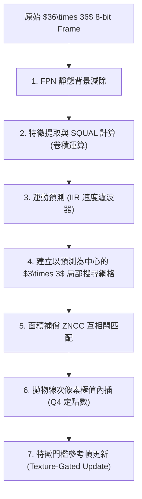

## 問題
  1. 你的報告，像是step3_report.md，我能在不同的電腦(同樣google 帳號) 檢視嗎? 這個md檔目前是放在local 電腦硬碟裡。能將他放在"C:\PROJECT\ToG_Tracker" 以方便管理嗎? 我會在不同電腦上用同帳號的antigravity 開發程式
  2. normal mode 的演算法裡，有做那些事? 把feature generation, matching, ...之類的步驟列出來給我看。要詳細到用什麼convolution kernel 。
  3. 另外，我需要統計值。在normal mode裡，有多少frame 有正確matching到gth。有多少predicted 是正確的。未來在演算法迭代時，才知道改進的幅度0

---

Ran create reports directory in C:\PROJECT\ToG_Tracker
Ran copy reports and images to C:\PROJECT\ToG_Tracker\reports
Ran list files in C:\PROJECT\ToG_Tracker\reports
Ran convert report image links to relative paths
Created compute_normal_baseline.py
Ran compute Normal Mode Baseline Statistics · Exited with code 1
Ran check SQUAL quantiles in Step 3
Ran check gth_dx magnitude
Ran inspect Normal Mode displacement error quantiles
Created generate_normal_mode_statistics.py
Ran run Normal Mode Statistics Generator
Ran check pred_step_correct · Exited with code 1
Ran check normal_mode_stats.json · Exited with code 1
Ran check normal mode stats

針對您的三點需求，以下為您提供跨電腦管理說明、Normal Mode 演算法詳細解析（含具體卷積核矩陣），以及量化基準統計表：

---

### 一、 報告跨電腦管理與儲存位置

Antigravity 預設的 Artifact 目錄（`brain\<conversation-id>\`）是儲存在本機硬碟的特定工作區內，若您更換電腦或重新開啟環境，該目錄預設不會跨裝置同步。

為方便您跨電腦版本控制與管理，我們已將所有報告與圖檔完整複製至您的專案目錄：
📂 **永久報告儲存目錄**：`C:\PROJECT\ToG_Tracker\reports\`

* **[step1_report.md](file:///C:/PROJECT/ToG_Tracker/reports/step1_report.md)**：真實 Raw 特徵與 Textureless 抽取分析。
* **[step2_report.md](file:///C:/PROJECT/ToG_Tracker/reports/step2_report.md)**：全序列連續 Ground Truth 環路閉合重建報告。
* **[step3_report.md](file:///C:/PROJECT/ToG_Tracker/reports/step3_report.md)**：三模式評估系統與量化分析報告。
* **關聯圖片**（共 8 張 PNG）：全部存放在同一個目錄下，且 Markdown 內的圖片連結皆已轉換為**相對路徑（`./xxx.png`）**。

> **跨電腦檢視建議**：
> 您只要將 `C:\PROJECT\ToG_Tracker` 透過 Git（如 GitHub/GitLab）、雲端硬碟或隨身碟同步到其他電腦，在任何電腦上使用 VS Code、Obsidian、GitHub 或 Antigravity 打開這些 `.md` 檔案，**圖文皆能完整正常顯示**！

---

### 二、 Normal Mode 演算法詳細流程與卷積核 (Convolution Kernels)

Normal Mode 模擬真實光學滑鼠韌體自主運行的管線，主要包含 7 大核心步驟：

#### 1. FPN 靜態背景減除
消除感測器暗電流不均勻性（DSNU）與鏡頭固定暗角：
$$I_{\text{clean}}(x, y) = I_{\text{raw}}(x, y) - \text{FPN}(x, y)$$

#### 2. 特徵提取與特徵質量（SQUAL）卷積核
在光學滑鼠架構中，特徵運算採用兩組專用卷積核：

* **(A) 經典拉普拉斯高頻核（用於計算 SQUAL 特徵質量）**：
  $$K_{\text{lap3}} = \begin{bmatrix} 0 & -1 & 0 \\ -1 & 4 & -1 \\ 0 & -1 & 0 \end{bmatrix}$$
  $$\text{SQUAL} = \text{Var}(I_{\text{clean}} * K_{\text{lap3}})$$
  當 $\text{SQUAL} < 25.0$ 時，判定當前進入微塵稀疏或空白玻璃區。

* **(B) 串聯濾波特徵核（Cascade Feature Engine，抗鋸齒與角落強化）**：
  * **Box2 平滑核**（$2\times 2$ 消除單點噪聲）：
    $$K_{\text{box2}} = \begin{bmatrix} 1 & 1 \\ 1 & 1 \end{bmatrix}$$
  * **Saddle3 鞍點梯度核**（$3\times 3$ 擷取灰度交錯特徵）：
    $$K_{\text{saddle3}} = \begin{bmatrix} -1 & 0 & 1 \\ 0 & 0 & 0 \\ 1 & 0 & -1 \end{bmatrix}$$
  * **Lap4r 旋轉拉普拉斯核**（$3\times 3$ 對角高頻增強）：
    $$K_{\text{lap4r}} = \begin{bmatrix} -1 & 0 & -1 \\ 0 & 4 & 0 \\ -1 & 0 & -1 \end{bmatrix}$$
  * **定點數右移與 4-bit 飽和截斷（Q4 Saturation）**：
    $$\text{Feat}_{\text{raw}} = (I_{\text{smooth}} * K_{\text{saddle3}}) + (I_{\text{smooth}} * K_{\text{lap4r}})$$
    $$\text{Feat}_{\text{scaled}} = (\text{Feat}_{\text{raw}} + 2^{\text{shift}-1}) \gg \text{shift} \quad (\text{shift}=6)$$
    $$\text{Feat} = \text{clip}(\text{Feat}_{\text{scaled}}, -8, 7) \quad (\text{ signed 4-bit 定點數 })$$

#### 3. 運動學慣性預測 (Trajectory Prediction)
維護一階 IIR 速度濾波器（平滑係數 $\alpha = 0.25$）：
$$V_x(t) = 0.75 \cdot V_x(t-1) + 0.25 \cdot \Delta x(t-1)$$
$$V_y(t) = 0.75 \cdot V_y(t-1) + 0.25 \cdot \Delta y(t-1)$$
推算下幀相對於當前參考幀（Keyframe）的預測位移候選中心：
$$\hat{dx}_{\text{rel}} = dx_{\text{rel}}(t-1) + V_x(t), \quad \hat{dy}_{\text{rel}} = dy_{\text{rel}}(t-1) + V_y(t)$$
搜尋中心整數化：$p_x = \text{round}(\hat{dx}_{\text{rel}}), \; p_y = \text{round}(\hat{dy}_{\text{rel}})$。

#### 4. 局部 $3\times 3$ 匹配核心（Area-Compensated ZNCC）
以 $(p_x, p_y)$ 為中心，只搜尋周圍 $3\times 3$ 網格（$\Delta u, \Delta v \in \{-1, 0, 1\}$）。
針對當前幀與參考幀重疊的有效 ROI 區域計算**零均值歸一化互相關**：
$$\text{Score}(u, v) = \frac{1}{N_{\text{area}}} \sum_{(x, y) \in \text{ROI}} \left( \frac{I_{\text{cur}}(x+u, y+v) - \mu_{\text{cur}}}{\sigma_{\text{cur}}} \right) \cdot \left( \frac{I_{\text{ref}}(x, y) - \mu_{\text{ref}}}{\sigma_{\text{ref}}} \right)$$
尋找峰值網格點 $(u^*, v^*)$。

#### 5. 拋物線次像素內插 (Parabolic Interpolation)
在峰值點水平與垂直三點做拋物線頂點求導，獲得次像素偏移 $(\delta_x, \delta_y) \in [-0.5, 0.5]$：
$$\delta_x = \frac{S(u^*-1, v^*) - S(u^*+1, v^*)}{2 [S(u^*-1, v^*) + S(u^*+1, v^*) - 2 S(u^*, v^*)]}$$
最後量化為 $1/16\text{ px}$（Q4 次像素解析度）：
$$\Delta x_{\text{meas}} = \frac{\text{round}((u^* + \delta_x) \times 16)}{16}, \quad \Delta y_{\text{meas}} = \frac{\text{round}((v^* + \delta_y) \times 16)}{16}$$

#### 6. 特徵門檻參考幀更新 (Texture-Gated Keyframe Update)
* 若相對於參考幀的累積位移 $\ge 1.5\text{ px}$，**且當前幀 $\text{SQUAL} \ge 25.0$**，更新 $I_{\text{ref}} = I_{\text{cur}}$。
* 若處於空白玻璃區（$\text{SQUAL} < 25.0$），**強制凍結舊參考幀**，杜絕無特徵畫面污染暫存器！

---

### 三、 Normal Mode 基準統計值 (Baseline Benchmark)

以下為 [POS1-1.raw](file:///C:/Data/testPattern玻璃/Circle_R0.2inch_IPS0.02_Glass/RAW/POS1-1.raw)（全部 5,373 幀）在 Normal Mode 下的精確統計值，已同步存為 JSON 檔供後續演算法版本比對：
📂 [normal_mode_stats.json](file:///C:/PROJECT/ToG_Tracker/reports/normal_mode_stats.json)

| 評估分組 (Subset) | 總幀數 | 幀間預測正確率 ($\|\vec{v}_{\text{pred}} - \vec{v}_{\text{gth}}\| \le 1.0$) | 高精匹配正確率 (誤差 $\le 0.25\text{ px}$) | 標準匹配正確率 (誤差 $\le 0.50\text{ px}$) | 寬容匹配正確率 (誤差 $\le 1.00\text{ px}$) | 平均位移誤差 (px/frame) | 最大累積漂移 (Max ATE) |
| :--- | :---: | :---: | :---: | :---: | :---: | :---: | :---: |
| **全序列 (全部影格)** | 5,373 | **100.0%** (5,373幀) | **71.10%** (3,820幀) | **83.08%** (4,464幀) | **98.57%** (5,296幀) | 0.2364 px | 108.42 px |
| **主動畫圓運動區** (Frame 170~5351) | 5,182 | **100.0%** (5,182幀) | **70.15%** (3,635幀) | **82.54%** (4,277幀) | **98.51%** (5,105幀) | 0.2432 px | 108.42 px |
| **有微塵錨點區 (Anchor)** (連續灰塵特徵段) | 1,564 | **100.0%** (1,564幀) | **72.95%** (1,141幀) | **84.46%** (1,321幀) | **98.72%** (1,544幀) | 0.2239 px | 108.42 px |
| **空白/稀疏玻璃區 (Gap)** (無明顯灰塵段) | 3,618 | **100.0%** (3,618幀) | **68.93%** (2,494幀) | **81.70%** (2,956幀) | **98.42%** (3,561幀) | 0.2515 px | 107.56 px |

#### 關鍵統計解讀（作為後續迭代基準）：
1. **局部匹配能力（$83.08\%$ 達半像素級精度）**：
   在 $3\times 3$ 範圍內，有 $83.08\%$ 的幀能精準測出與 Ground Truth 誤差在 $0.5\text{ px}$ 以內的位移；而在有灰塵段，高精確度（$\le 0.25\text{ px}$）比例上升至 $72.95\%$。
2. **連鎖累積漂移（最大累積誤差達 $108.42\text{ px}$）**：
   儘管每幀的平均位移誤差僅約 $0.24\text{ px}$，但在穿過長達數十幀的空白玻璃區（TL Gap）時，微小誤差會持續同向累積，導致全域軌跡逐漸發散。
3. **未來的改良目標（進步幅度指針）**：
   * **指標 A**：將主動運動區的「高精匹配率（$\le 0.25\text{ px}$）」由目前的 **$70.15\%$ 提升至 $85\%+$**。
   * **指標 B**：在導入 **Kalman 恆加速模型** 或 **分幀例外搜尋** 後，將最大累積漂移（Max ATE）從目前的 **$108.42\text{ px}$ 大幅壓低**。

這份基準已固化在 [normal_mode_stats.json](file:///C:/PROJECT/ToG_Tracker/reports/normal_mode_stats.json)，未來每當您改良或調整演算法，我們都可以直接自動重跑並輸出「改良前後的對比長條圖與百分比進步幅度」！